# 1 · Electrónica, armado, mediciones y pruebas de banco

Encargados: Iván, Arianna, Mía. Plan del frente: [PLAN.md, Frente 1](../PLAN.md#frente-1--electrónica-armado-y-pruebas-de-banco).

**Por dónde empezar:** lee la tabla de pines, mira el diagrama de protoboard de cada caja y después [guias/guia_ensamble.md](guias/guia_ensamble.md).

## Contenido

| Carpeta | Qué hay |
|---|---|
| `protoboard/` | Dónde va cada pieza y cada cable (PNG/SVG) y su tabla punto a punto (`.md`) |
| `esquematicos/` | Esquemático simple de cada nodo |
| `wireviz/` | Diagrama de cables por caja y lista de materiales (`.bom.tsv`) |
| `kicad/` | Esquemáticos en KiCad 10; `pdf_svg/` para verlos sin instalar nada |
| `fritzing/` | Los mismos nodos en Fritzing (`.fzz`) y sus imágenes |
| `fuente/layouts.py` | Fuente de verdad del armado: de aquí salen la protoboard, WireViz y el CAD |
| `guias/` | Ensamble, armado paso a paso, prueba de la LDR, caja de potencia (opcional), presupuesto |

## Pines

Todos los nodos: **D7** LED verde y **D8** LED rojo, cada uno con 330 Ω a GND; **C1 = 220 µF/16 V** entre VIN y GND (respetar la polaridad).

| Nodo | Pin | Conexión |
|---|---|---|
| `dht` | D4 (GPIO2) | DATA del DHT22, pull-up 10 kΩ a 3V3 |
| `dht` | D1 / D2 | SCL / SDA de la OLED SSD1309 2.42" (3V3) |
| `dht` | D5 (GPIO14) | Base del 2N2222 por 1 kΩ (R3); 10 kΩ base–GND (R4). Buzzer: + a VIN, − al colector, emisor a GND |
| `dht` | D6 (GPIO12) | Botón de silencio a GND (`INPUT_PULLUP`) |
| `luz` | A0 | Divisor: LDR a 3V3 + 10 kΩ (R2) a GND |
| `pir` | D5 (GPIO14) | OUT del HC-SR501 (alimentado a VIN, salida de 3.3 V) |
| `puerta` | D5 (GPIO14) | Reed MC-38 a GND (`INPUT_PULLUP`) |
| `acel` | D1 / D2 | SCL / SDA del ADS1115 (dirección 0x48, ADDR a GND); GY-61 X/Y/Z a A0/A1/A2 del ADS1115 |
| `luz_rele` (opcional) | D1 / D2 / D5 | IN1 / IN2 / IN3 del módulo de 4 relés (activo en bajo) |

Reglas:

- A **3V3**: DHT22, GY-61, ADS1115, divisor de la LDR, OLED. A **5 V (VIN)**: PIR y buzzer.
- Evitar D3 y D4 para entradas por el arranque (D4 se usa para el DHT22 porque su pull-up la deja en alto). D8 debe estar en bajo al arrancar: el LED a GND lo cumple.
- En cada estación hay 2 NodeMCU en la misma MB-102: los rieles de 5 V y GND se unen; **el 3V3 de cada placa nunca se une**. Hay que confirmar con multímetro que el riel de 3V3 esté partido.
- Una fuente de 5 V por caja; las estaciones entran por un módulo USB-C a VIN.

## Las 3 cajas

### `dht`
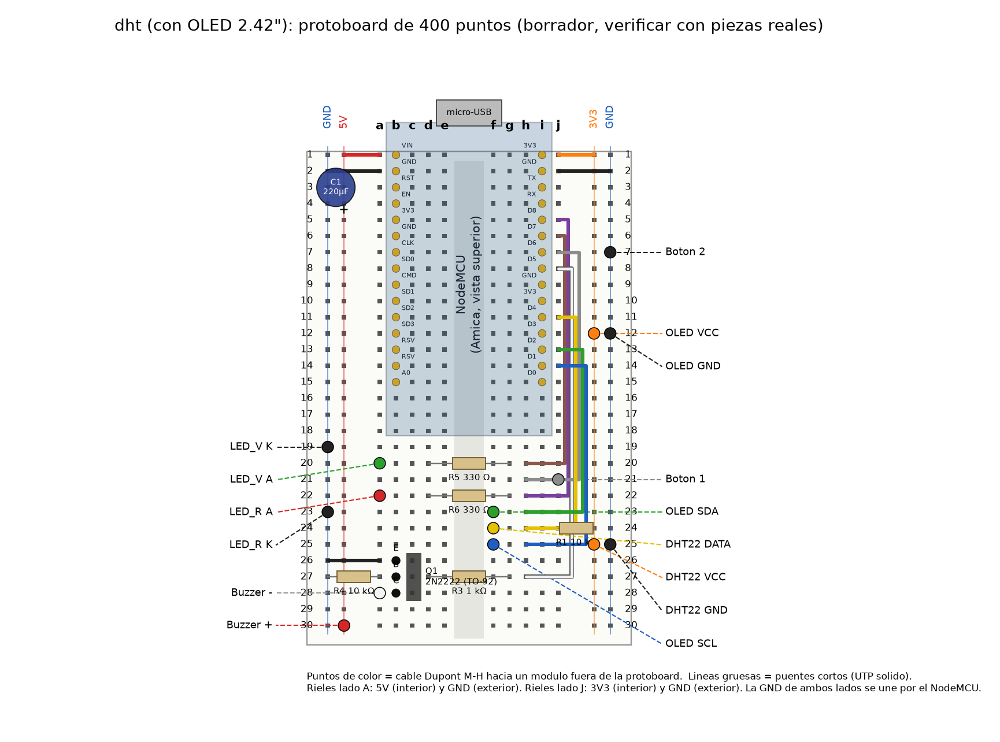
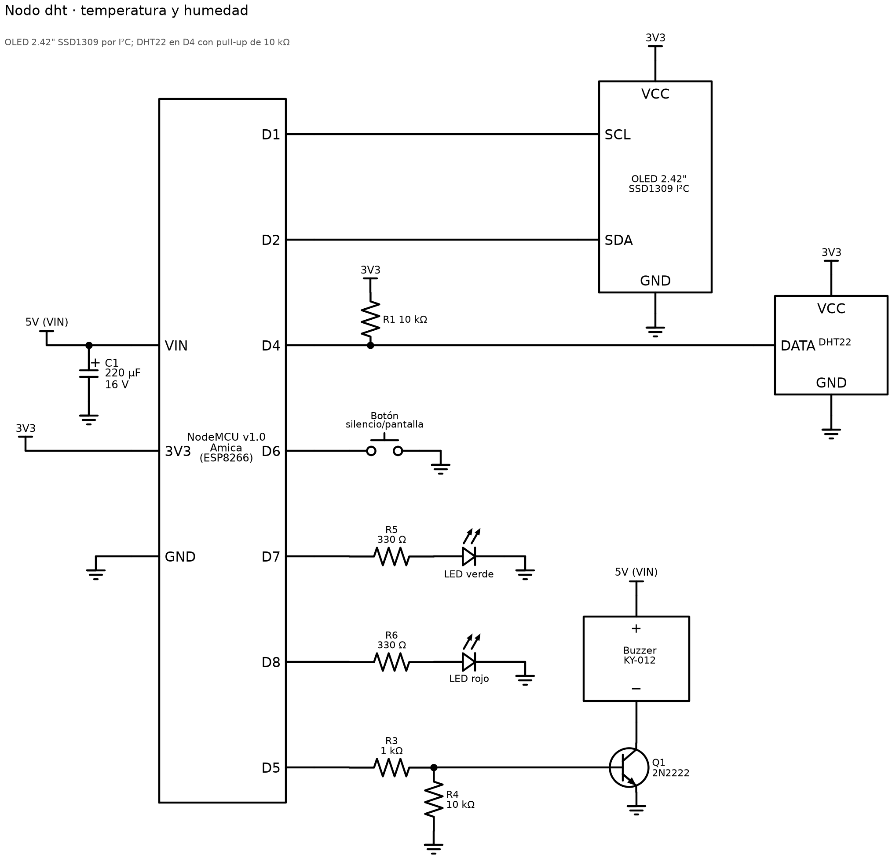
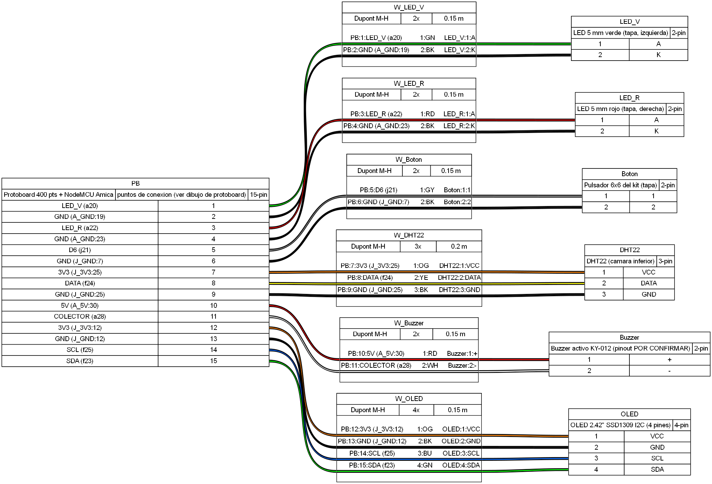

### Estación de entrada (`pir` + `puerta`)
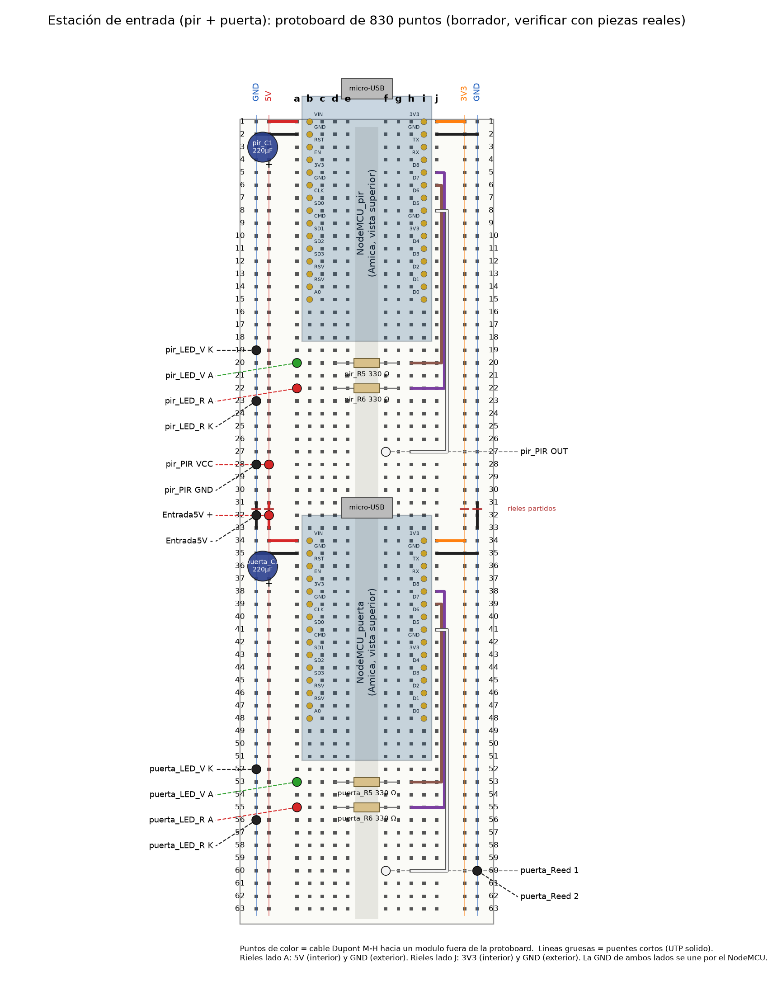
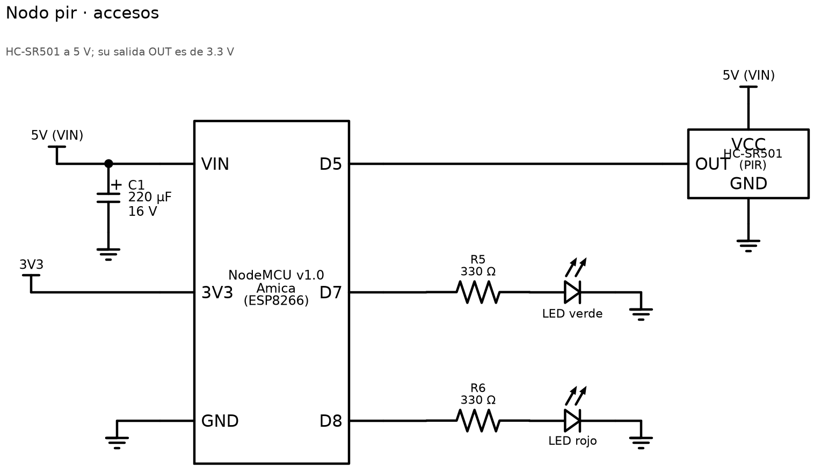
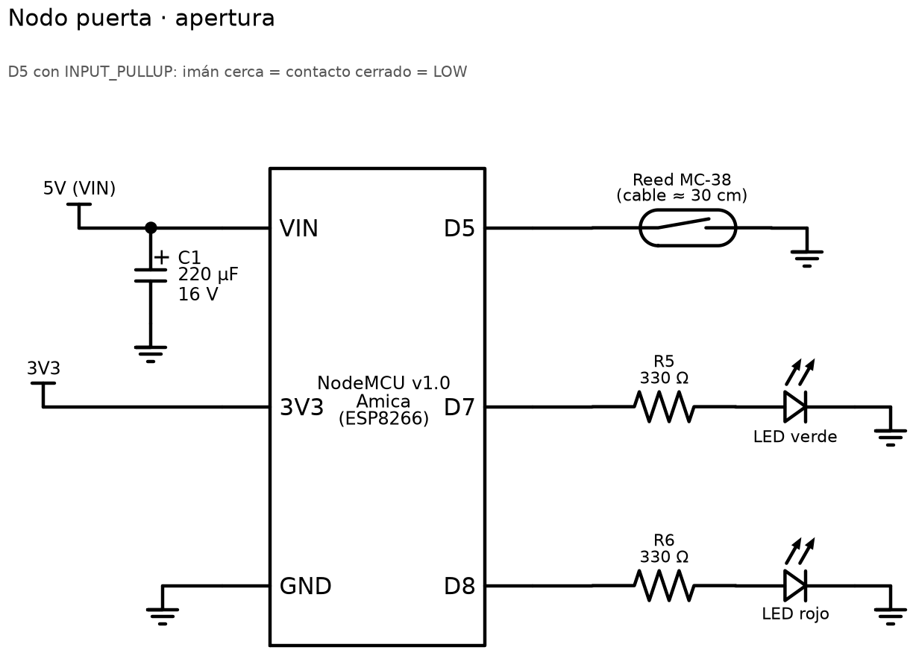
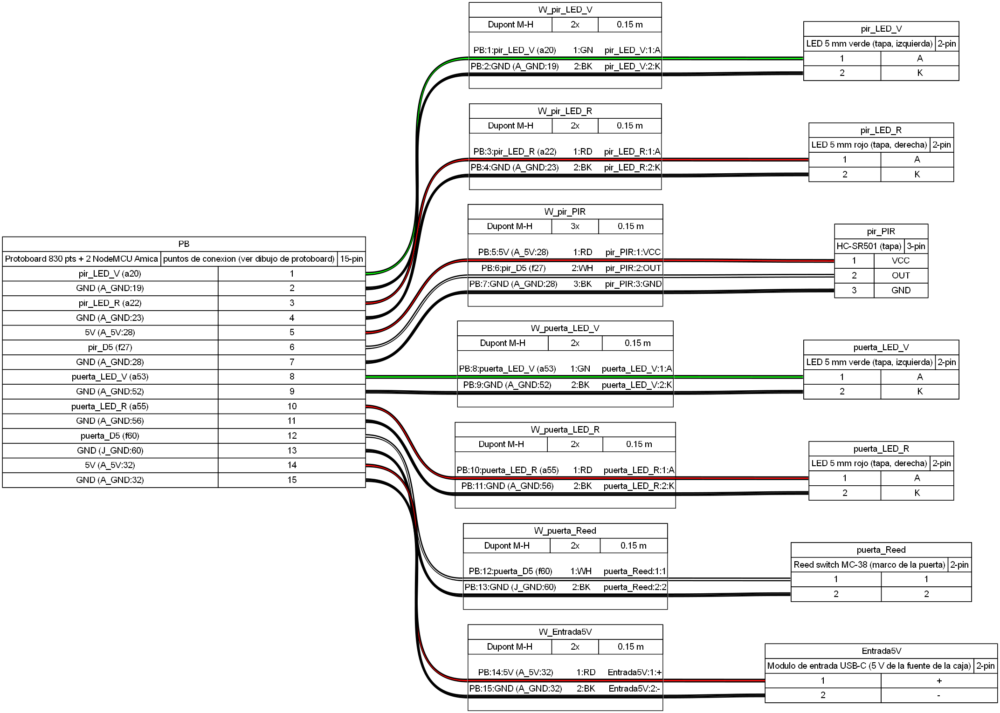

### Estación del anaquel (`acel` + `luz`)
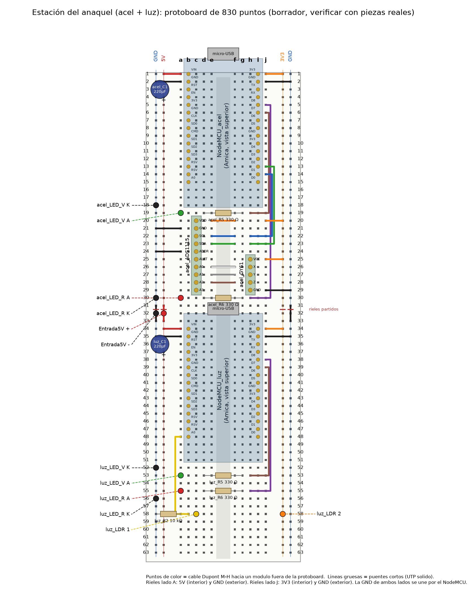
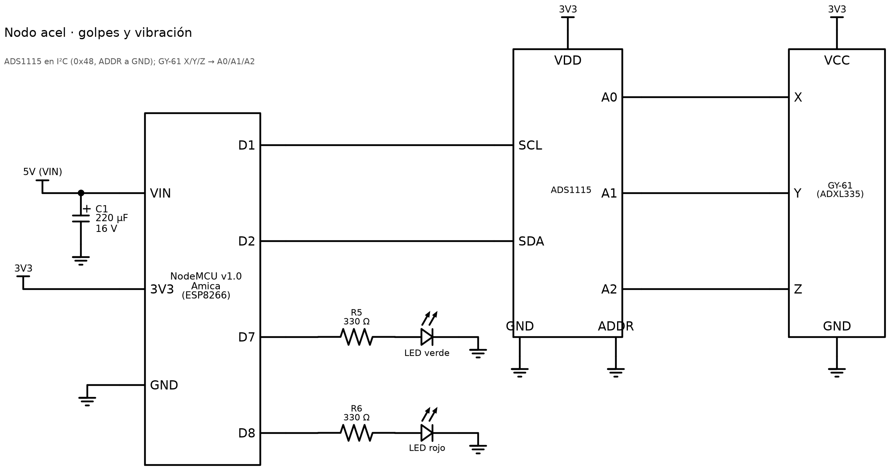
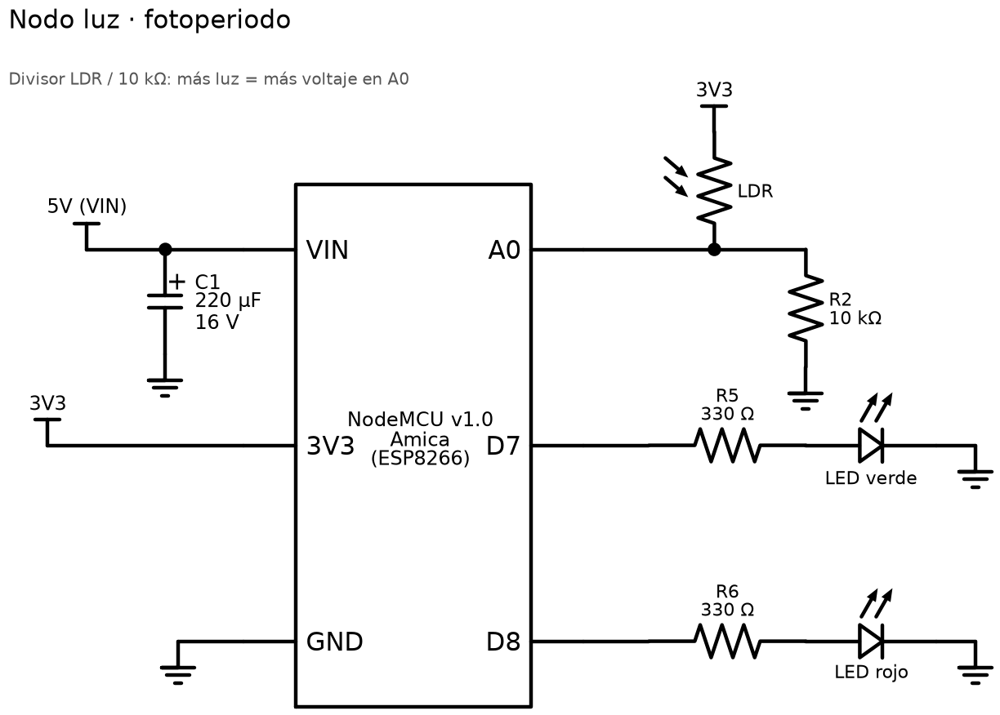
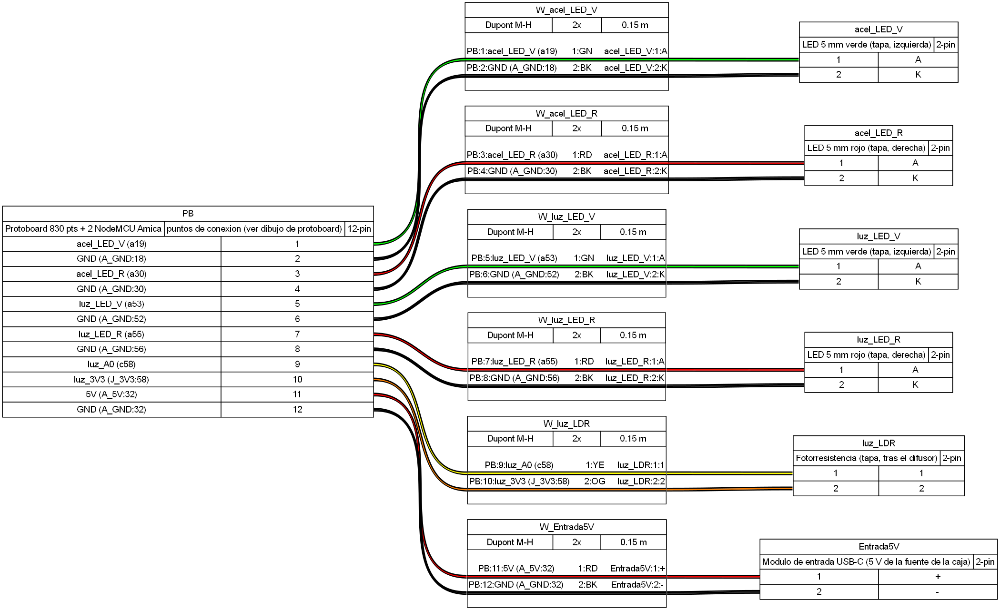

## Mientras llega el hardware

1. Estudiar los temas de investigación del [PLAN](../PLAN.md) (pinout, 3.3 V vs 5 V, divisor, transistor, pull-up, I²C).
2. Preparar la tabla de medición (componente, medida esperada, medida real) con la lista de componentes de [guias/guia_ensamble.md](guias/guia_ensamble.md).
3. Preparar el checklist de armado de cada caja a partir de las tablas de `protoboard/*.md`.
4. Revisar con el Frente 3 qué se debe ver en el monitor serie al probar cada sensor.
