# 2 · Carcasas 3D: diseño, uniones, impresión e instalación

Encargadas: Mía y Arianna. Plan del frente: [PLAN.md, Frente 2](../PLAN.md#frente-2--carcasas-3d-uniones-e-instalación-en-el-cuarto).

**Por dónde empezar:** mira los renders de abajo, abre el visor y lee [guias/impresion_3d.md](guias/impresion_3d.md). Luego anota qué mejorarías del diseño.

## Contenido

| Carpeta | Qué hay |
|---|---|
| `renders/` | Imágenes de cada caja, vistas acotadas, cortes, explosionada y el cuarto |
| `visor/` | Página web del prototipo con los modelos 3D interactivos |
| `imprimir/3mf/` | Piezas listas para el laminador (orientación de impresión) |
| `imprimir/stl/` | Las mismas piezas en STL |
| `imprimir/pruebas_ajuste/` | Peine de holguras y piezas de prueba: **se imprimen primero** |
| `modelo_cuarto/` | Cuarto con las cajas instaladas (`cuarto.glb`) y largos de cable (`cables.json`) |
| `codigo/` | Código build123d que genera todo (`nodos.py`, `cuarto.py`, `caja_potencia.py`) y las medidas (`medidas.json`) |
| `imprimir/modular_stl/` | Piezas de la variante modular (clips y tapa a presión) |
| `guias/` | Impresión, pruebas de ajuste, informe de verificación, plano de ubicación y variante modular |

## Las cajas

| `dht` | Estación de entrada | Estación del anaquel |
|---|---|---|
| 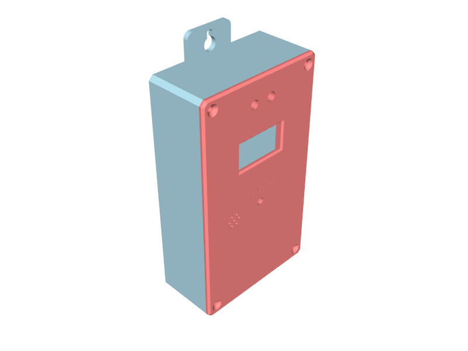 | 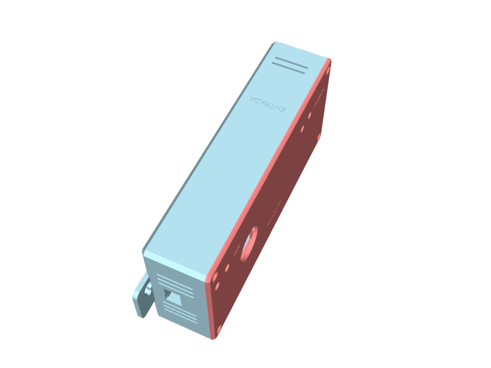 | 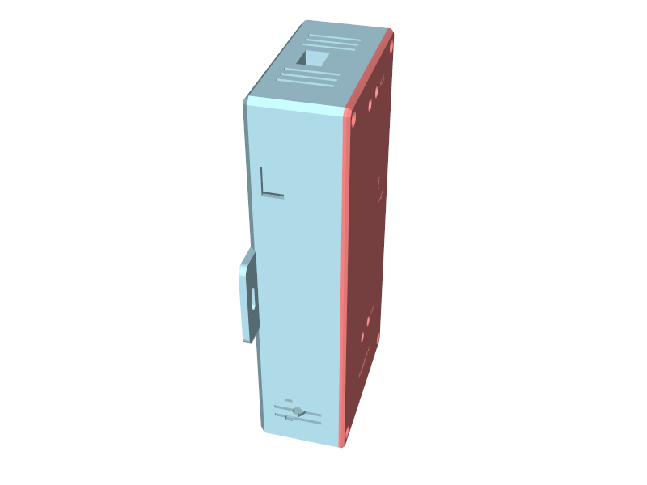 |

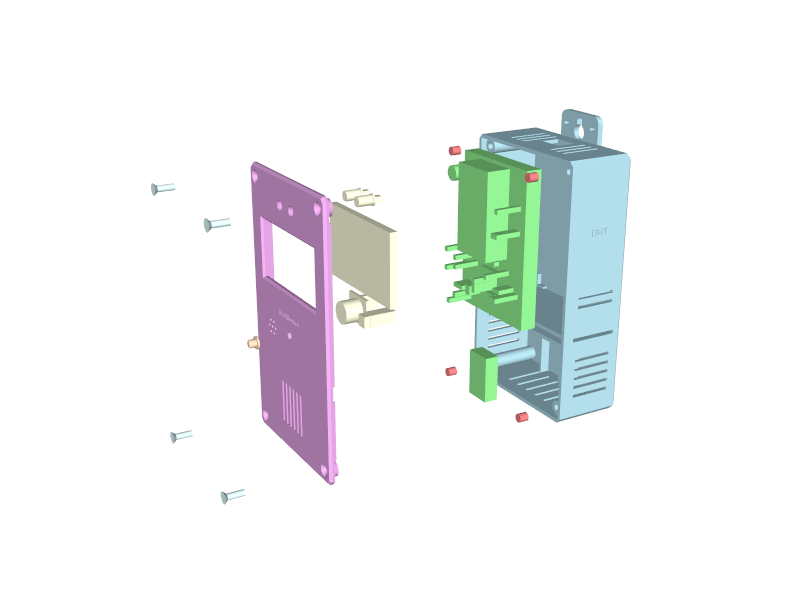
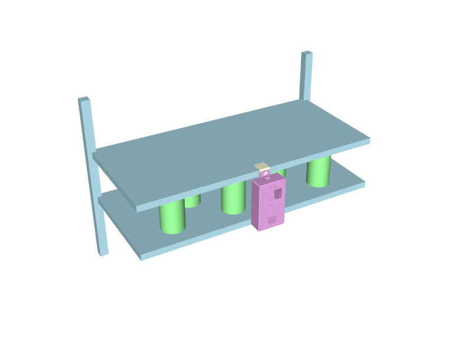

Accesorios: capuchón de la LDR y portas del MC-38.

| Capuchón LDR | Porta sensor MC-38 | Porta imán MC-38 |
|---|---|---|
| 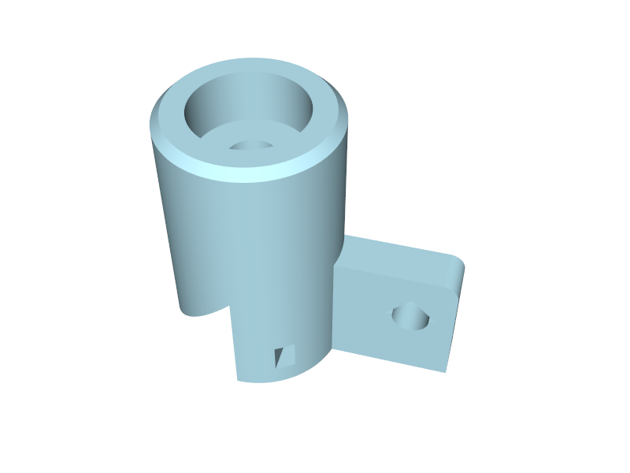 | 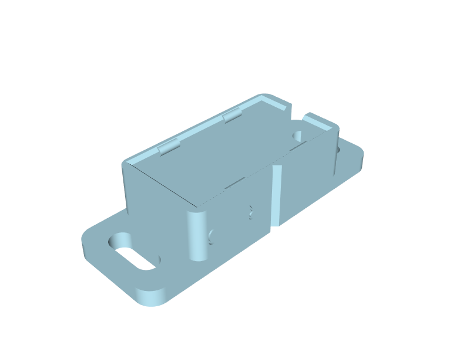 | 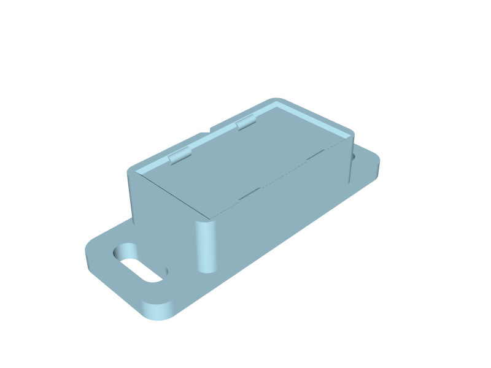 |

## Variante modular (10-nov): encajes a presión

Modelo base nuevo de las tres cajas: la protoboard entra con **clips**, la tapa cierra **a presión, sin tornillos ni insertos**, y la OLED lleva una **grapa**. Todo es nominal; se afina con el cupón de clips antes de imprimir. Detalle, verificación e ideas de forma: [guias/carcasas_modulares.md](guias/carcasas_modulares.md).

| `dht` cerrada | Estación de entrada cerrada |
|---|---|
| 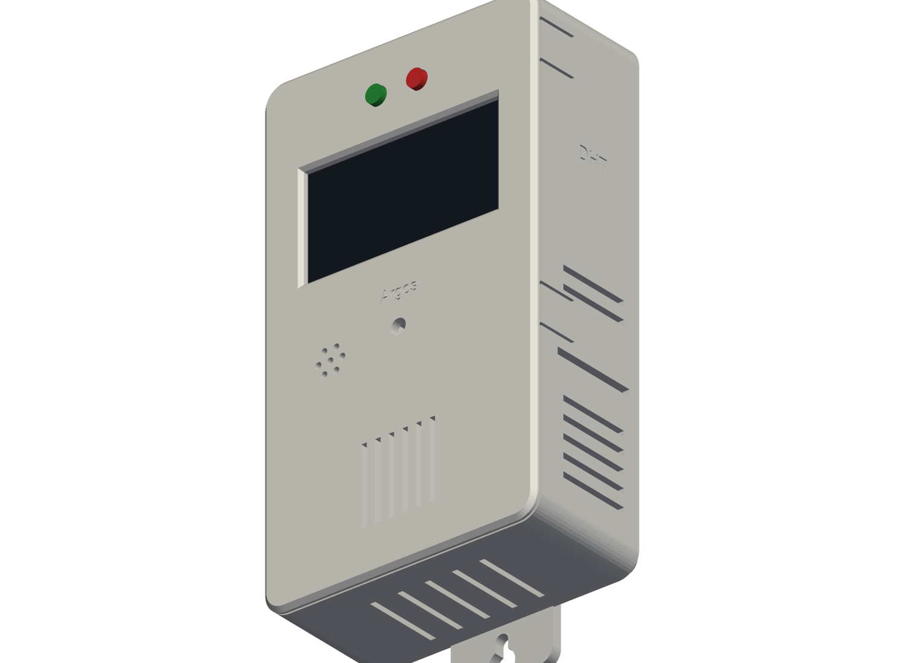 | 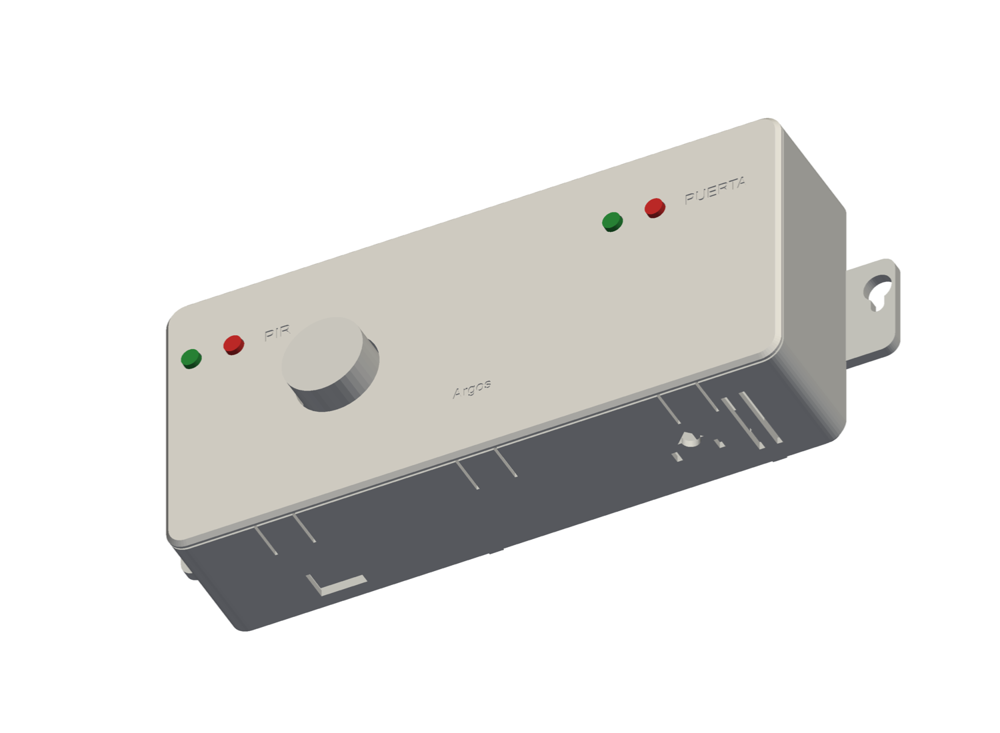 |

| Protoboard con clips (`dht`) | Protoboard con clips (estación) |
|---|---|
| 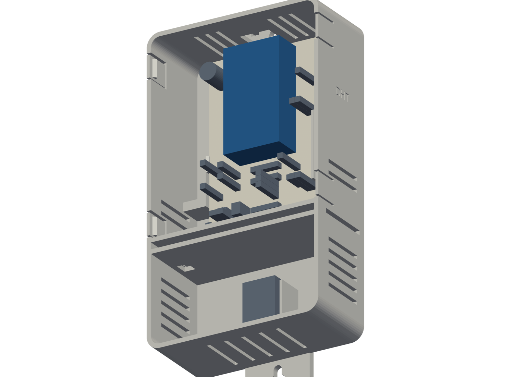 | 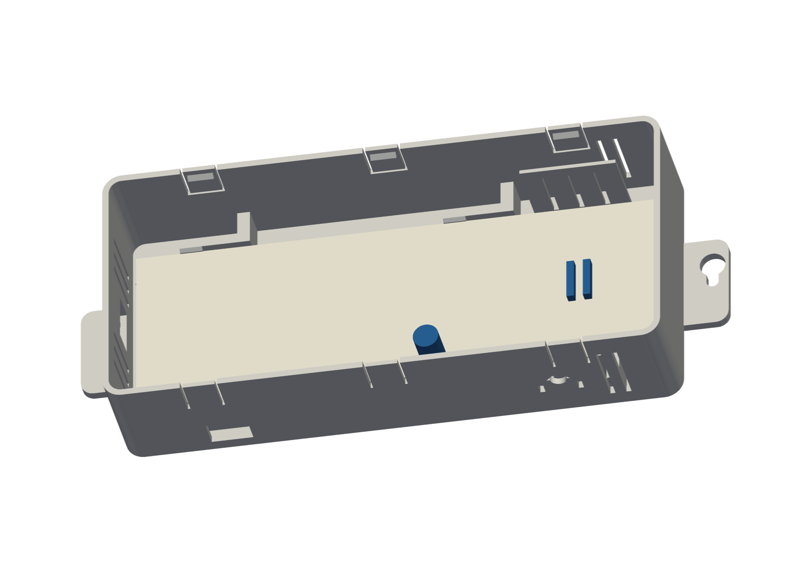 |

| Tapa por dentro: OLED con su grapa (naranja) y pestañas de los broches | Explosionada |
|---|---|
| 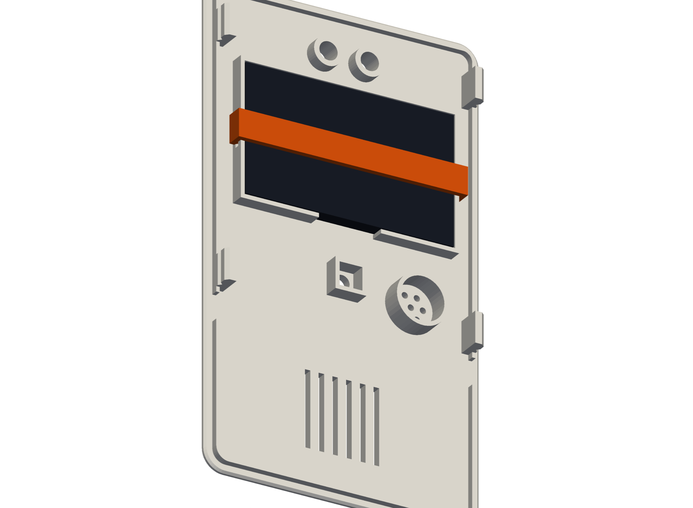 | 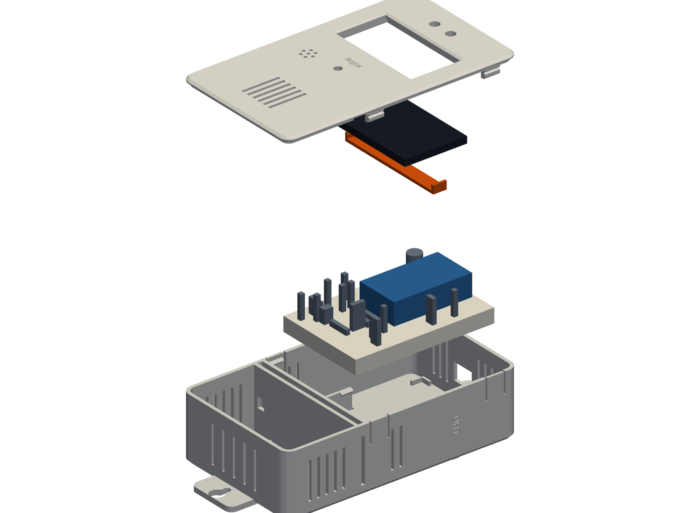 |

- Piezas: `imprimir/modular_stl/`. Cupón de clips (se imprime primero): `imprimir/pruebas_ajuste/prueba_clips_base.stl` y `prueba_clips_tira.stl`.
- El cableado no cambia: los esquemáticos y dibujos de protoboard de `1_electronica/` siguen vigentes.
- **Tarea del frente:** decidir si se adopta, y definir la **forma e identidad** de las cajas con [guias/ideas_forma.md](guias/ideas_forma.md): ideas generales (persianas del DHT22, ojo de Argos y otras), qué investigar de cada una y una tabla para decidir.

## El cuarto

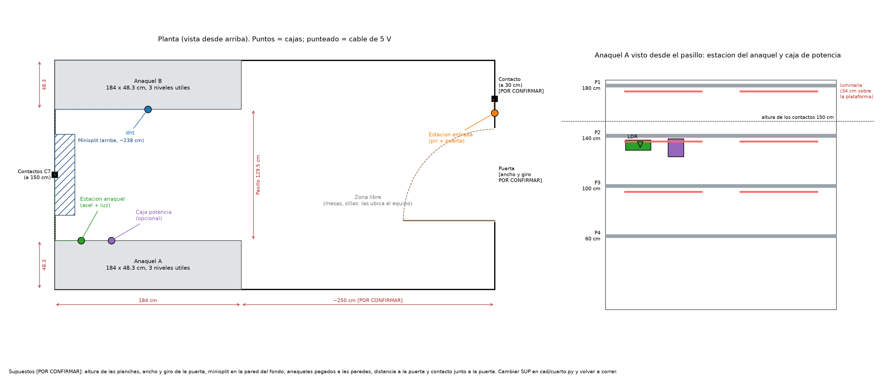
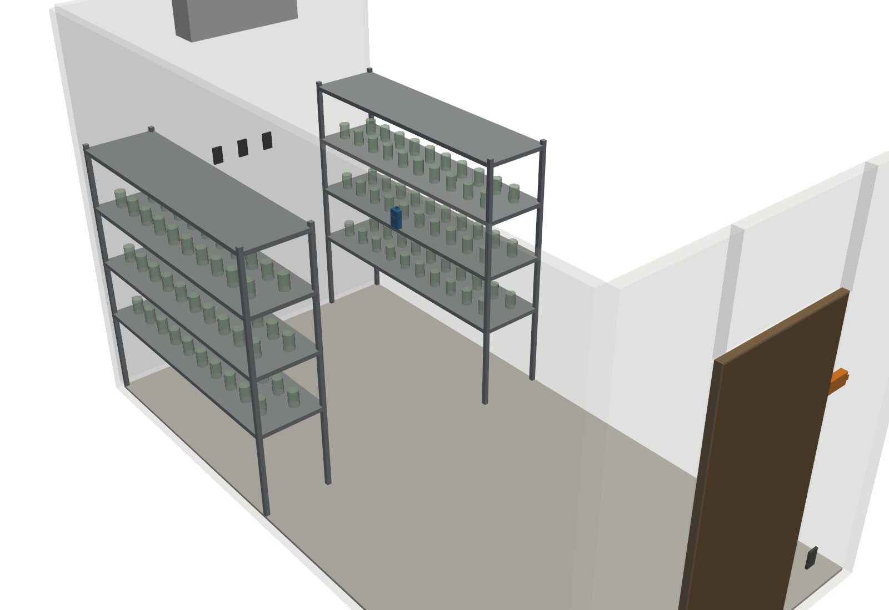

Las posiciones y medidas marcadas `[POR CONFIRMAR]` están en [guias/plano_ubicacion.md](guias/plano_ubicacion.md).

## Cómo abrir el visor

El visor carga archivos con JavaScript, así que no basta con doble clic. En una terminal dentro de `2_carcasas_3d/visor/`:

```bash
python -m http.server 8000
```

y abre `http://localhost:8000` en el navegador.

## Cómo cambiar el diseño

- Las medidas de las piezas están en `codigo/medidas.json`; la geometría en `codigo/nodos.py` (una función por nodo).
- Comando (necesita `uv`; Luis lo corre en el repo principal, porque el código también lee `1_electronica/fuente/layouts.py`):

```bash
uv run --no-project --python 3.12 --with "build123d>=0.10,<0.14" --with matplotlib python cad/nodos.py
```

- Requisitos de diseño vigentes: paredes de 2 mm, holgura 0.3 mm, chaflanes de 2–3 mm, imprimible sin soportes, tapa con 4 × M3 (o a presión en la variante modular), espacio para sílica, ventilación pasiva, ID del nodo y "Argos" en relieve, superficie lisa limpiable con alcohol, PETG en las piezas finales.
- Propuestas de mejora: un boceto o una lista con qué cambiar y por qué (estética, uniones, armado, montaje). Se discuten y Luis las aplica en el repo principal si no se hace en el código directamente.
