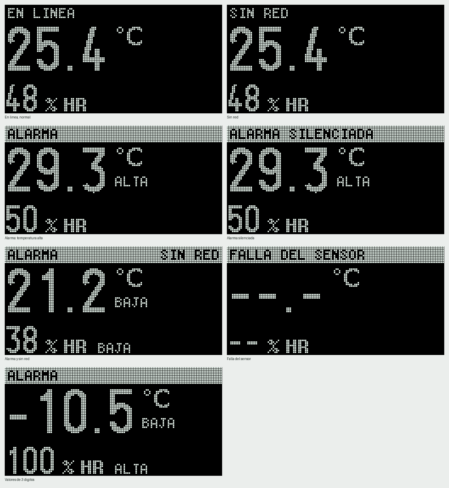
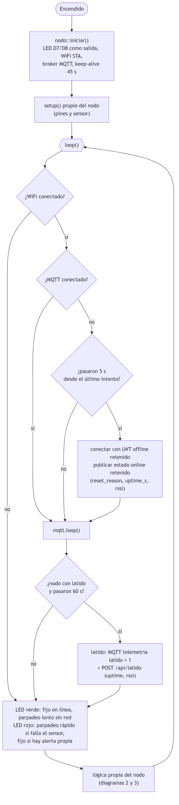
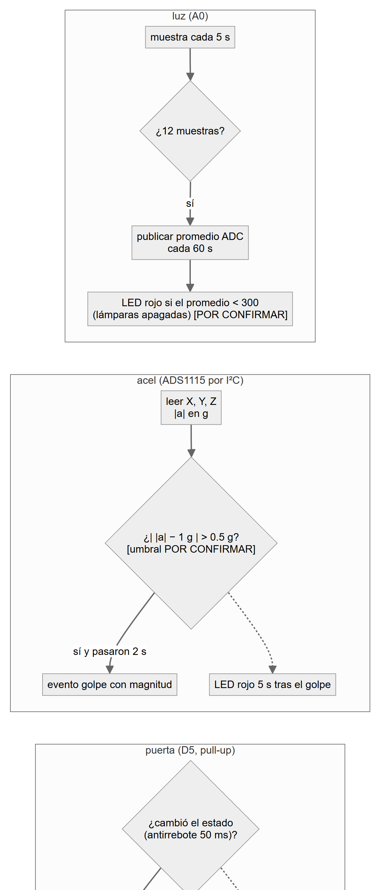
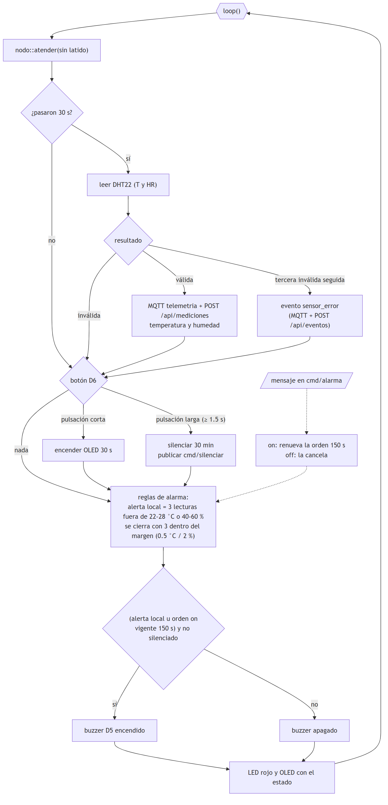

# 3 · Firmware y pruebas simuladas

Encargado: Luis. Plan del frente: [PLAN.md, Frente 3](../PLAN.md#frente-3--firmware-y-pruebas-simuladas).

## Contenido

| Carpeta | Qué hay |
|---|---|
| `firmware/src/<nodo>/` | Código de cada nodo (PlatformIO) |
| `firmware/include/` | Código común: conexión, alarma del `dht`, pantalla OLED, envío HTTP; `secrets.example.h` |
| `firmware/arduino_ide/` | Los mismos programas como sketches de Arduino IDE (una carpeta por nodo) |
| `firmware/herramientas/` | Pruebas en PC de las reglas del buzzer (`prueba_alarma.py`) y vista previa de la OLED |
| `firmware/platformio.ini` | Entornos `dht`, `dht_sin_oled`, `luz`, `luz_rele`, `pir`, `puerta`, `acel` |
| `simulador/` | Simula los 5 nodos por MQTT, sin hardware |
| `guias/` | Arduino IDE (instalación y librerías) y estados de la pantalla |

## Contrato MQTT (no se modifica)

Cada nodo usa su propio usuario MQTT, igual al sufijo del topic; client id `nodo-<id>`; keep-alive de 45 s.

| Topic | Dirección | Ejemplo de mensaje | QoS / retenido |
|---|---|---|---|
| `invernadero/telemetria/{nodo}` | nodo → servidor | `{"lecturas":[{"parametro":"temperatura","valor":25.4,"unidad":"C"}]}` | 0 / no |
| `invernadero/evento/{nodo}` | nodo → servidor | `{"tipo":"golpe","magnitud":1.8}` (`movimiento`, `golpe`, `puerta_abierta`, `puerta_cerrada`, `sensor_error`) | 0 / no |
| `invernadero/estado/{nodo}` | nodo / LWT | `{"estado":"online","reset_reason":"Power on","uptime_s":12,"rssi":-62}`; LWT `{"estado":"offline"}` | 1 / sí |
| `invernadero/cmd/alarma` | servidor → `dht` | `on` / `off`, cada 60 s | 0 / no |
| `invernadero/cmd/silenciar` | `dht` → servidor | `{"minutos":30}` | 0 / no |

Latido cada 60 s. `dht` publica cada 30 s; `luz` muestrea cada 5 s y publica el promedio cada 60 s; `pir`, `puerta` y `acel` publican por evento. Además, los nodos guardan las lecturas por HTTP POST en la API (`4_servidor`).

## Comportamiento

- **Buzzer** (solo `dht`, solo temperatura y humedad): suena si hay alarma local o `cmd/alarma = on` vigente (150 s), y no está silenciado. Persistencia de 3 lecturas; histéresis de 0.5 °C y 2 % HR. Botón D6: corto enciende la pantalla, largo silencia 30 min.
- **LED verde:** fijo = todo bien; parpadeo lento = sin WiFi o sin servidor.
- **LED rojo:** fijo = alerta propia; parpadeo rápido = falla del sensor. `pir` 5 s tras movimiento; `puerta` mientras está abierta; `acel` 5 s tras un golpe; `luz` cuando lee lámparas apagadas.



## Flujo del firmware

Cada lectura o evento sale por dos caminos: MQTT (tiempo real) y HTTP POST a la API (lo que se guarda). Los diagramas ayudan a seguir el código; la versión editable está en [../diagramas/firmware_flujo.md](../diagramas/firmware_flujo.md).

**Parte común (los 5 nodos)**



**Nodos de evento y de luz (`pir`, `puerta`, `acel`, `luz`)**



**Nodo `dht`**



## Pruebas sin hardware

```bash
python firmware/herramientas/prueba_alarma.py
uv run --no-project --python 3.12 --with paho-mqtt python simulador/simulador_nodos.py --escenario calor --rapido
```

Escenarios del simulador: `normal`, `calor`, `sin_red`, `golpes`. Necesita el broker del Frente 4 y las variables de `.env.example` llenas en un `.env` local (nunca se sube).

## Flasheo (cuando llegue el hardware)

1. Copiar `secrets.example.h` a `secrets.h` y llenar WiFi, MQTT y API.
2. Arduino IDE: abrir `firmware/arduino_ide/argos_<nodo>/`, placa *NodeMCU 1.0 (ESP-12E)*. PlatformIO: `pio run -e <nodo> -t upload`.
3. Un nodo a la vez, con el monitor serie a 115200.
