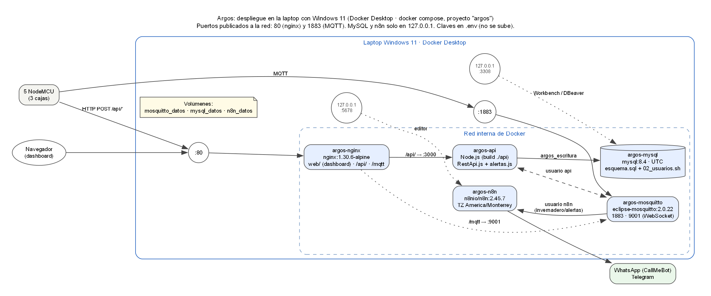

# 4 · Servidor, base de datos, API, alertas y dashboard

Encargados: José María y Luis. Plan del frente: [PLAN.md, Frente 4](../PLAN.md#frente-4--servidor-base-de-datos-alertas-y-dashboard).

**Por dónde empezar:** [guias/tutorial_servidor.md](guias/tutorial_servidor.md) (paso a paso con Docker).

El servidor es una **laptop con Windows 11 y Docker Desktop**. El mismo compose podría ir después a Oracle Cloud (lección 8 del tutorial), pero es opcional.



## Contenido

| Carpeta | Qué hay |
|---|---|
| `servidor/docker-compose.yml` | Mosquitto 2.0.22, MySQL 8.4, n8n, API y nginx |
| `servidor/mosquitto/` | Configuración y ACL (un usuario por nodo). El archivo de contraseñas se genera en cada compu y no se sube |
| `servidor/api/` | API REST en Node.js (Express + mysql2): `RestApi.js` y `alertas.js` |
| `servidor/mysql/` | Usuarios de escritura y lectura |
| `servidor/nginx/`, `servidor/web/` | Proxy y página web (aquí va el dashboard) |
| `servidor/crear_usuarios_mqtt.sh`, `generar_secretos.py` | Crean usuarios y claves locales |
| `bd/` | Esquema (`esquema.sql`), documento de la Etapa 2 y scripts de la Etapa 3 (datos de prueba e indicadores por nodo) |
| `guias/` | Tutorial del servidor y diseño de la API de consulta |

## Arquitectura

```
nodos ──MQTT──▶ Mosquitto ──▶ n8n (alertas: WhatsApp / Telegram)
nodos ──HTTP POST──▶ API Node.js ──▶ MySQL (UTC)
dashboard ──GET /api/...──▶ nginx ──▶ API ;  dashboard ◀──MQTT.js── Mosquitto (en vivo)
```

## Endpoints de la API

| Método | Ruta | Para qué |
|---|---|---|
| POST | `/api/mediciones` | Lecturas de los nodos |
| POST | `/api/eventos` | Movimiento, golpe, puerta |
| POST | `/api/acciones` | Acciones de los actuadores |
| POST | `/api/latido` | Latido de cada nodo |
| GET | `/api/comandos/:nodo` | Comandos pendientes para un nodo |
| GET | `/api/estado` | Último valor y estado de cada nodo |
| GET | `/api/mediciones` | Historial |
| GET | `/api/alertas` | Alertas |

## Alertas graves (umbrales ajustables después en el dashboard)

- Temperatura o humedad fuera de rango (22–28 °C, 40–60 % HR) por más de 15 min.
- Nodo caído por más de 15 min.
- Luces que no siguen el horario.
- Puerta abierta por más de 10 min.

Se envían de 7:00 a 22:00 (America/Monterrey; la BD guarda en UTC). Fuera de ese horario se acumulan y a las 7:00 llega un resumen solo si hubo algo grave. Una alerta por episodio.

## Claves

`.env.example` (en la raíz) y `servidor/api/config_local.example` solo traen nombres. Cada quien crea su `.env` local con `generar_secretos.py`; nunca se sube.
