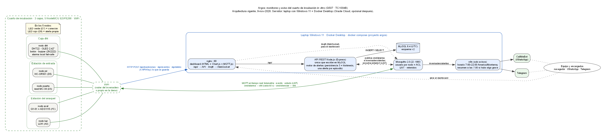

# Argos · repositorio del equipo (lectura).

Sistema IoT de **monitoreo y aviso** para el cuarto de incubación in vitro del Invernadero Académico (Tec de Monterrey). Equipo G507, TC1004B.

Este repositorio es **solo para leer y organizarnos**: cada carpeta es un frente de trabajo con lo necesario para entenderlo. El proyecto que se entrega vive en otro repositorio, donde cada quien hará sus commits.

**Empieza por [PLAN.md](PLAN.md)**: auditoría, calendario, los 5 frentes y qué entrega cada uno.

## Qué hace Argos

- Mide temperatura y humedad (rango 22–28 °C y 40–60 % HR), la luz de las lámparas, movimiento en la entrada, apertura de la puerta y golpes en el anaquel.
- Cada sensor tiene su NodeMCU ESP8266 (5 en total) repartidos en **3 cajas**: `dht` (con pantalla y buzzer), estación de entrada (`pir` + `puerta`) y estación del anaquel (`acel` + `luz`).
- Los nodos mandan datos por HTTP (lo que se guarda) y MQTT (tiempo real) al servidor: una **laptop con Windows 11 y Docker Desktop** que corre Mosquitto, la API Node.js (con el motor de alertas), MySQL, n8n (avisos) y el dashboard web. Oracle Cloud queda como opción para después.
- Avisos graves por WhatsApp y Telegram de 7:00 a 22:00; fuera de horario se acumulan y llega un resumen a las 7:00.
- Futuro (opcional): controlar el fotoperiodo de las luminarias con relés.

## Frentes

| Carpeta | Frente | Encargados |
|---|---|---|
| [1_electronica](1_electronica/) | Electrónica, armado, mediciones y pruebas de banco | Iván, Arianna, Mía |
| [2_carcasas_3d](2_carcasas_3d/) | Carcasas 3D: diseño, uniones, impresión e instalación | Mía, Arianna |
| [3_firmware](3_firmware/) | Firmware y pruebas simuladas | Luis |
| [4_servidor](4_servidor/) | Servidor, BD, API, alertas y dashboard | José María, Luis |
| [5_expo](5_expo/) | ExpoIngenierías y entregables | Todo el equipo |

`diagramas/` tiene la arquitectura, el despliegue en Docker (Graphviz: `.dot` + PNG/SVG) y el flujo del firmware (`firmware_flujo.md`, GitHub dibuja los diagramas).

**Arranque: martes 10 de noviembre.** Fechas en [PLAN.md](PLAN.md#2-calendario-que-manda).

## Cómo verlo sin saber git

- En GitHub: navega por las carpetas; los `.md` y las imágenes se ven directo.
- Para tenerlo en tu compu: botón **Code → Download ZIP**.
- Modelos 3D: los `.3mf`, `.stl` y `.glb` abren con el Visor 3D de Windows o el laminador.
- Esquemáticos: los PDF de `1_electronica/kicad/pdf_svg/`.

## Equivalencia de rutas

Las guías copiadas mencionan rutas del repositorio principal. Aquí están:

| En las guías dice | Aquí está |
|---|---|
| `hardware/breadboard/` | `1_electronica/protoboard/` y `1_electronica/fuente/layouts.py` |
| `hardware/kicad/`, `hardware/wiring/`, `hardware/fritzing/` | `1_electronica/kicad/`, `wireviz/`, `fritzing/` |
| `cad/*.py`, `cad/medidas.json` | `2_carcasas_3d/codigo/` |
| `cad/exports/` | `2_carcasas_3d/imprimir/` y `modelo_cuarto/` |
| `cad/renders/` | `2_carcasas_3d/renders/` |
| `presentacion/` | `2_carcasas_3d/visor/` |
| `firmware/`, `simulador/` | `3_firmware/` |
| `servidor/`, `docs/bd/` | `4_servidor/servidor/`, `4_servidor/bd/` |
| `docs/<guia>.md` | la carpeta `guias/` del frente que corresponde |
| `CLAUDE.md` | el `README.md` de cada frente (pines en `1_electronica`, MQTT en `3_firmware`) |

## Claves

No hay contraseñas en este repositorio. `.env.example`, `secrets.example.h` y `config_local.example` solo traen los nombres; los valores reales nunca se suben.
