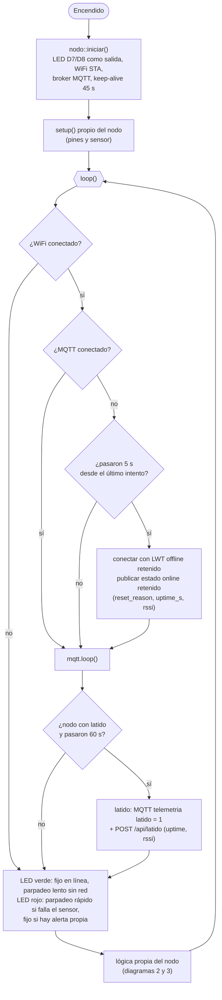
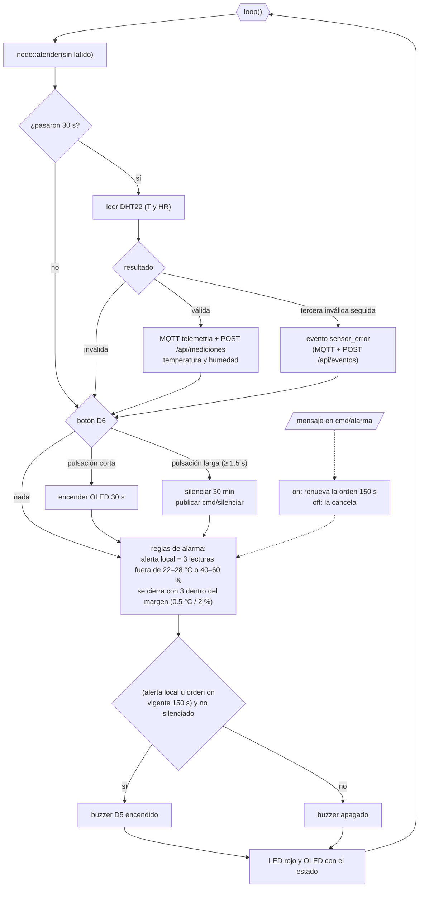
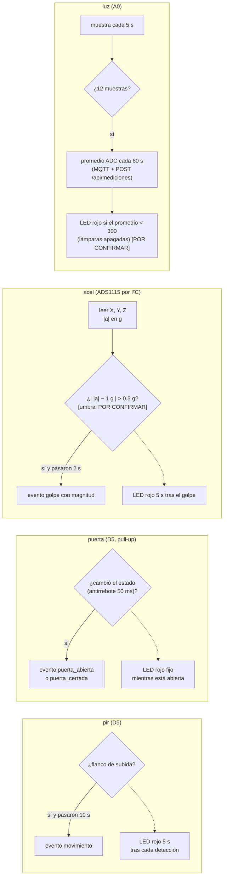

# Flujo del firmware de los nodos

Actualizado el 9-nov-2026. Sale del código de `firmware/` (compilado, sin probar en placa). La parte común está en `include/nodo_comun.h`; el envío a la API, en `include/api_http.h`; las reglas del buzzer, en `include/alarma_dht.h`.

Cada lectura o evento sale por **dos caminos independientes**: MQTT (tiempo real, si hay broker) y **HTTP POST a la API** (`/api/mediciones`, `/api/eventos`, `/api/latido`, `/api/acciones`), que es lo que se guarda en MySQL. Si el POST falla por red o error 5xx se reintenta una vez; un 400 o 401 no se reintenta.

## 1. Parte común (los 5 nodos)

Cada `loop()` empieza con `nodo::atender()`: mantiene WiFi y MQTT, manda el latido y pinta los LED.

Latido: lo mandan `pir`, `puerta` y `acel`. `dht` (cada 30 s) y `luz` (cada 60 s) ya mandan datos seguido y no lo necesitan.

## 2. Nodo dht

## 3. Nodos de evento y de luz

Lo que decide si algo es alerta en el servidor (temperatura y humedad con las mismas reglas del firmware, puerta abierta, golpe, nodo sin reporte) lo evalúa el **motor de alertas de la API** (`servidor/api/alertas.js`), no el nodo. n8n solo manda los avisos por WhatsApp y Telegram con horario.
